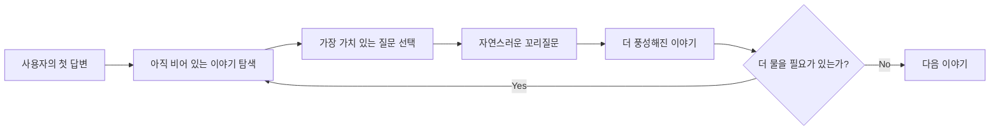
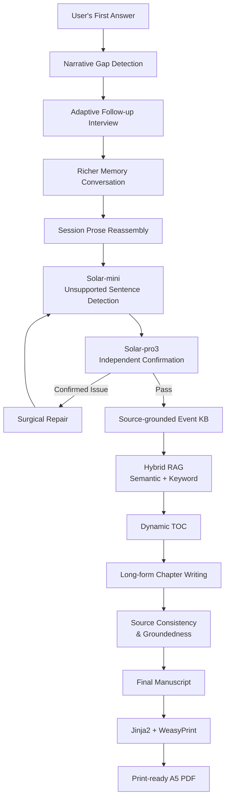
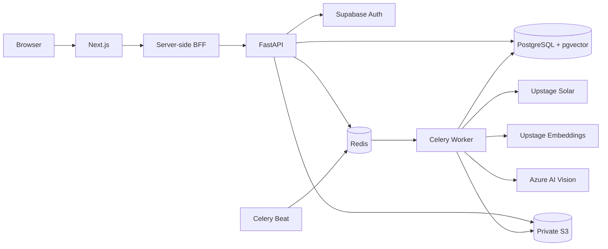
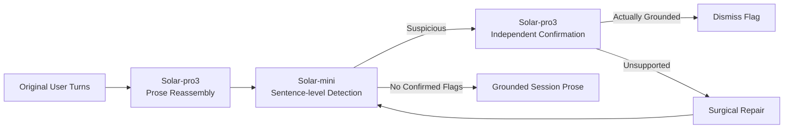
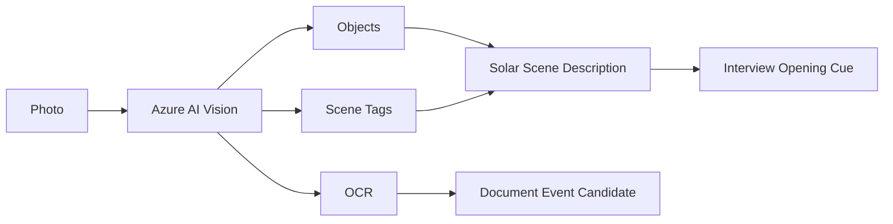
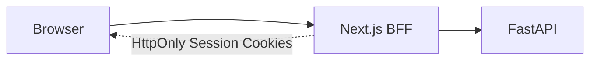
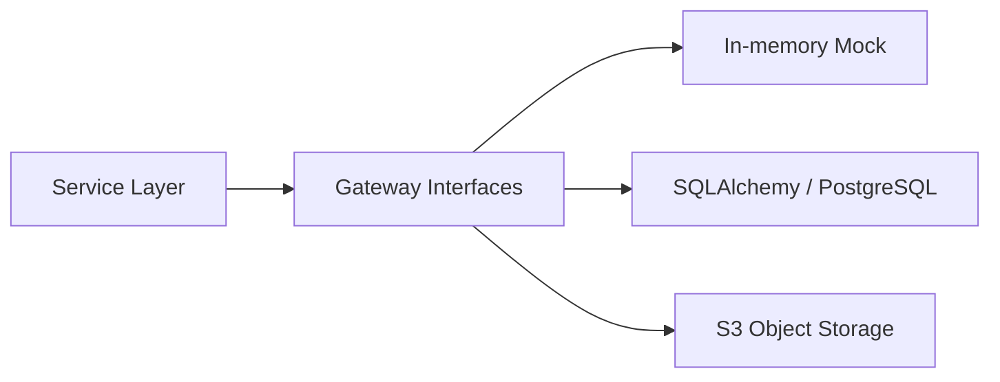

<div align="center">

# Meminisse

### Conversational AI Autobiography Platform

**사용자의 첫 답변에서 아직 충분히 이야기되지 않은 빈틈을 찾고,  
좋은 꼬리질문으로 추억을 더 풍성하게 끌어낸 뒤,  
그 대화를 자연스럽게 한 권의 자서전으로 완성합니다.**

<br/>

[](https://github.com/tangerineYR/meminisse/actions/workflows/ci.yml)


<br/>

> **From a first answer to a fuller memory,  
> from conversation to autobiography.**

</div>

---

## 📌 Overview

**Meminisse**는 사용자가 빈 화면 앞에서 처음부터 자서전을 직접 써 내려가도록 요구하지 않습니다.

사람의 기억은 처음부터 완성된 이야기의 형태로 나오지 않습니다.

처음에는 다음과 같이 짧고 어렴풋한 답변으로 시작할 수 있습니다.

```text
"대학교 때 친구들과 부산 여행을 갔어요."
```

하지만 한 편의 자서전 속 장면이 되기 위해서는 아직 이야기되지 않은 부분이 많습니다.

```text
언제였는가?
어디였는가?
누구와 함께했는가?
무슨 일이 있었는가?
그때 어떤 감정을 느꼈는가?
그 경험은 나에게 어떤 의미였는가?
```

Meminisse는 이러한 부분을 사용자의 기억에서 **틀린 사실**로 취급하지 않습니다.

대신 현재 답변에서 아직 충분히 이야기되지 않은 **서사적 빈틈(Narrative Gap)**으로 보고,
그중 지금 대화에서 가장 가치 있는 지점을 골라 자연스러운 꼬리질문을 이어갑니다.

```text
First Answer
    ↓
Narrative Gap Detection
    ↓
Adaptive Follow-up Question
    ↓
Richer Memory Conversation
    ↓
Source-grounded Event Memory
    ↓
Autobiography Writing
```

Meminisse가 만들고자 한 경험은:

> **“자서전을 써야 한다”**

가 아니라,

> **“추억을 즐겁게 이야기하다 보니 어느새 내 자서전이 완성되어 있었다”**

에 가깝습니다.

따라서 시스템의 핵심은 자서전을 잘 **써주는 것**만이 아니라,
사용자로부터 이야기를 잘 **끌어내는 것**에 있습니다.

이후의 Distortion Detection과 Groundedness Check 역시
사용자의 오래된 기억이 현실 세계에서 객관적으로 사실인지 판정하기 위한 기능이 아닙니다.

그 목적은 명확합니다.

**사용자가 실제로 말하지 않은 사건·감정·관계·수치를 LLM이 자서전의 사실처럼 새로 만들어내지 않도록 하는 것**입니다.

---

# 🗂️ Project Info

| 항목 | 내용 |
| --- | --- |
| **프로젝트** | Meminisse |
| **유형** | Upstage 연계 학술 프로젝트 · 2인 팀 |
| **Git 개발 기록** | 2026.04.05 – 2026.07.20 |
| **역할** | **Full-stack Development · Backend / Frontend Focus** |
| **Team Repository** | 97 main-branch commits · 9 merged PRs |
| **My Git History** | 56 author-attributed main commits · 8 merged PRs authored |
| **Backend** | FastAPI · SQLAlchemy Async · Celery · Redis |
| **Frontend** | Next.js 16 · React 19 · TypeScript · Tailwind CSS 4 |
| **AI** | Upstage Solar · Upstage Embeddings · Azure AI Vision |
| **Data** | Supabase PostgreSQL · pgvector · AWS S3 |
| **Publishing** | Jinja2 · WeasyPrint · pypdf |
| **Original Team Repository** | [Meminisse-team/meminisse-repository](https://github.com/Meminisse-team/meminisse-repository) |

> ### Collaboration
>
> 전체 제품과 AI workflow는 팀에서 함께 개발했습니다.
>
> 개인적으로는 **FastAPI Backend, 비동기 작업 처리, RAG/Data Pipeline,
> Backend–Frontend Integration 및 Next.js Frontend 기능 구현**에 상대적으로 더 집중했고,
> 팀원은 **Prompt Engineering과 Prompt Quality 고도화**에 상대적으로 더 집중했습니다.
>
> 이 저장소는 원본 팀 Repository를 기반으로 한 개인 Portfolio Fork이며,
> 프로젝트 종료 후 Security, Module Boundaries, Frontend Architecture,
> Evaluation Reproducibility, Tests/CI 등을 추가로 보강했습니다.

---

# 💡 Product Design

## Autobiography as Conversation, not Homework

기존 자서전 작성은 사용자에게 높은 인지적 부담을 요구합니다.

```text
무엇부터 써야 하지?
어떤 이야기가 중요한가?
얼마나 자세히 써야 하지?
글을 어떻게 구성해야 하지?
```

Meminisse는 이 부담을 사용자가 아니라 시스템이 가져가도록 설계했습니다.

사용자는 자신의 경험을 평소처럼 말하고,
Agent는 그 답변을 듣고 다음에 무엇을 물어야 할지 판단합니다.



목표는 질문의 개수를 늘리는 것이 아닙니다.

**이미 이야기한 내용은 다시 묻지 않고,
한 사건을 더 생생하고 의미 있게 만드는 데 필요한 질문만 남기는 것**이 핵심입니다.

---

# 🏗️ System Architecture

## End-to-End Flow



---

## Runtime Infrastructure



HTTP request와 수십 초 이상 걸릴 수 있는 AI/Vision/PDF 작업을 분리하여,
긴 외부 API 호출이 사용자 요청 lifecycle을 직접 점유하지 않도록 구성했습니다.

---

# ⚙️ Engineering Highlights

## 1. Narrative Gap-aware Proactive Interview

Meminisse의 Interview Agent는 정해진 질문을 기계적으로 읽는 설문지가 아닙니다.

사용자의 답변에서 아직 충분히 드러나지 않은 이야기의 차원을 탐지하고,
그 지점에 맞는 질문을 생성합니다.

코드에서는 이를 6개의 Required Slot으로 구체화했습니다.

| Slot | 의미 |
| --- | --- |
| `place` | 어디에서 |
| `time` | 언제 |
| `event` | 무슨 일이 있었는지 |
| `emotion` | 어떤 감정을 느꼈는지 |
| `values` | 그 경험이 어떤 의미였는지 |
| `companion` | 누구와 함께했는지 |

이 Slot은 사용자의 기억을 객관적으로 검증하기 위한 체크리스트가 아닙니다.

**현재 이야기를 더 풍성하게 만들 수 있는 빈틈을 찾기 위한 Interview Planning Signal**입니다.

```text
Latest Answer
     │
     ▼
Slot Gating
     │
     ├─ Missing Required Slot
     │      └─ Targeted Follow-up
     │
     ├─ Core context is present but story is too short
     │      └─ Elaboration Follow-up
     │
     └─ Writer-worthy unexplored point exists
            └─ Contextual Follow-up
```

필수 정보가 이미 충분하다면 단순히 Slot을 더 채우기 위해 질문하지 않습니다.

답변 전체가 짧을 경우에는 장면·감각·속마음 등을 자연스럽게 떠올릴 수 있는
**Elaboration Follow-up**으로 전환하고,

필수 Slot과 분량 기준까지 충족된 이후에도 실제 전기 작가라면 더 물어볼 만한
여운·인과관계·전환점이 있는 경우에만 **Contextual Follow-up**을 시도합니다.

---

## 2. Reflective Narrative Dimensions

Required Slot이 한 사건의 맥락을 구체화한다면,
Additional Slot은 경험의 의미를 더 깊이 회상할 수 있도록 돕는
**Reflective Narrative Dimension**으로 사용합니다.

```text
gratitude
regret
turning_point
pride
belief
message
```

특히 인생 전체를 돌아보는 성찰형 질문에서는
연도·장소 같은 사건형 Slot을 억지로 채우지 않도록 별도 예외 처리를 둡니다.

즉 모든 답변을 같은 template으로 강제하지 않고,
질문의 성격에 따라 필요한 정보의 기준도 달리합니다.

---

## 3. Follow-up Budget

좋은 인터뷰가 질문을 많이 하는 인터뷰라는 가정을 두지 않았습니다.

한 사건에 대한 Follow-up은 최대:

```text
2회
```

로 제한합니다.

```text
Enough Context?
   │
   ├─ No  → Follow-up
   │
   └─ Yes → Contextual Check / Wrap-up

Follow-up Budget Exhausted?
   │
   └─ Yes → Wrap-up
```

이미 충분히 이야기된 사건을 계속 캐묻는 것보다
자연스럽게 다음 기억으로 넘어가는 사용자 경험을 우선했습니다.

---

## 4. Conversation-grounded Generation

Interview 단계에서는 사용자가 자유롭게 자신의 기억을 이야기합니다.

Meminisse는 그 기억이 역사적으로 정확한지,
사용자가 느낀 감정이 객관적으로 맞는지 판정하지 않습니다.

대신 **시스템 자신이 새로운 사실을 만들어내지 않는 것**을 책임집니다.

Session 종료 후 여러 대화 turn을 1인칭 산문으로 재구성할 때:



1차 Judge가 스스로 자신의 판정을 다시 확인하도록 하지 않고:

```text
Solar-mini
    ↓
Solar-pro3 independent confirmation
```

으로 역할을 분리했습니다.

Solar-pro3가 원문에 실제 근거가 있다고 판정한 문장은
Solar-mini의 false positive로 보고 철회합니다.

---

## 5. Surgical Repair instead of Full Regeneration

문제 문장이 하나 발견됐다고 Session 전체를 다시 생성하지 않습니다.

```text
Unsupported Sentence
        ↓
Original User Turns
        ↓
Local Rewrite
        ↓
Re-validation
```

부분 수정은 최대 두 번 수행합니다.

그 이후에도 통과하지 못하면:

```text
distortion_flagged = true
        ↓
Session Prose is preserved
        ↓
Event Extraction is held
        ↓
User Review / Correction
```

로 처리합니다.

즉 생성 실패를 감추고 downstream pipeline을 계속 진행하는
fail-open 방식이 아니라, 불확실한 상태를 명시적으로 남기고
사용자가 확인할 수 있도록 설계했습니다.

---

## 6. Source-grounded Event Knowledge Base

대화 전체를 그대로 Vector DB에 넣지 않습니다.

Session 대화에서 의미 있는 사건을 별도 `Event` 객체로 추출합니다.

```text
Conversation
    ↓
Session Prose
    ↓
Event Extraction
    ↓
Event
 ├─ one_line_summary
 ├─ prose_paragraph
 ├─ life_period
 ├─ place
 ├─ people
 ├─ labels
 ├─ confidence
 ├─ source
 ├─ importance_score
 └─ embedding
```

RAG에서는 다음 조건을 만족하는 Event만 사용합니다.

```text
verified = true
embedding != null
duplicate_of_event_id = null
```

> 여기서 `verified`는 해당 기억이 현실 세계의 객관적 사실임을
> 외부 자료로 검증했다는 의미가 아닙니다.
>
> Conversation 또는 사용자가 제공한 자료에 근거해 downstream generation에
> 사용할 수 있는 상태임을 나타내는 application-level gate입니다.

OCR처럼 출처가 불확실할 수 있는 데이터는 별도로 보수적으로 처리하며,
의심스러운 경우 `verified=false` 상태로 RAG에서 제외합니다.

---

## 7. Hybrid RAG with Query / Passage Embeddings

Event 저장과 검색에 서로 다른 Upstage embedding model을 사용합니다.

```text
Stored Event
    │
    └─ embedding-passage
            ↓
      PostgreSQL + pgvector


Chapter Query
    │
    └─ embedding-query
            ↓
       Semantic Search
            +
       Keyword Search
            ↓
       Merge / Deduplicate
            ↓
        Chapter Context
```

Semantic Search는 사용자의 `verified` Event 중
query vector와의 cosine distance를 기준으로 검색합니다.

Keyword Search는 chapter title을 토큰화한 뒤
`one_line_summary ILIKE` 검색을 함께 수행합니다.

이를 통해 의미적으로 비슷한 기억뿐 아니라
고유명사나 명시적인 키워드 기반 기억도 함께 찾도록 구성했습니다.

---

## 8. 4096-d Embedding에 대한 의도적 Exact Search

현재 Upstage `embedding-query` / `embedding-passage`의 실제 응답은
**4096 dimensions**입니다.

프로젝트가 사용한 pgvector 환경에서는 해당 차원에 대해
HNSW/IVFFlat ANN index를 그대로 적용하기 어려웠기 때문에,
Event vector에는 ANN index를 두지 않고:

```text
ORDER BY embedding <=> query
LIMIT N
```

형태의 exact cosine similarity search를 사용합니다.

현재 서비스 규모에서는 사용자 한 명당 Event cardinality가 크지 않다는 점을 고려한 선택이며,
향후 Event 수가 크게 증가하면 dimension reduction + reranking 또는
별도 retrieval architecture를 다시 검토할 수 있습니다.

---

## 9. Photo as a Memory Cue

사진은 단순히 최종 자서전에 삽입하는 Asset만이 아닙니다.

**사용자가 기억을 더 쉽게 떠올릴 수 있도록 하는 대화의 실마리(Memory Cue)**로 사용합니다.



Azure AI Vision에서는 한 번의 분석 요청으로:

```text
objects
tags
read
```

를 사용합니다.

Azure의 자연어 Caption 기능은 사용하지 않습니다.

Object/Tag 결과는 영어 label 형태이므로
Solar가 이를 한국어 대화에 활용할 수 있는 scene description으로 정리합니다.

OCR text가 충분히 존재하면:

```text
TEXT_DOCUMENT
```

track으로,

텍스트가 사실상 없는 일반 추억 사진은:

```text
PURE_MEMORY
```

track으로 처리합니다.

즉 Computer Vision의 목적도 사진의 의미를 완벽하게 판정하는 것이 아니라,
**사용자가 더 쉽게 기억을 꺼낼 수 있는 질문의 단서를 제공하는 것**입니다.

---

## 10. Fault-tolerant Async Pipeline

세션 후처리, Media 분석, Chapter Writing, Finalization, PDF Generation처럼
오래 걸리는 작업을 Celery Worker로 분리했습니다.

```text
FastAPI
   │
   ▼
Redis Broker
   │
   ├─ Session Processing
   ├─ Media Analysis
   ├─ Autobiography Consolidation
   ├─ Chapter Writing
   ├─ Final Manuscript
   └─ PDF Generation
        │
        ▼
   Celery Worker
```

비동기 처리에는 단순 queueing뿐 아니라:

- retry / exponential backoff
- duplicate enqueue protection
- Redis `SET NX EX` lock
- Celery Beat
- stale-session reconciliation
- worker health check

를 함께 구성했습니다.

Chapter Writing은 일시적인 실패 시 자동 retry를 수행하고,
Session / Chapter / Finalization / PDF 작업에는 중복 queueing을 방지하는 lock을 둡니다.

Celery Beat는 **5분 주기**로 처리 지연 Session을 검사하여
유실 가능성이 있는 작업을 재큐잉합니다.

---

## 11. Dynamic Long-form Writing Pipeline

충분한 Event가 축적되면 자서전 생성 단계로 넘어갑니다.

```text
Event KB
   ↓
Consolidation
   ↓
Dynamic TOC Candidates
   ↓
User Selection
   ↓
Chapter-level Hybrid RAG
   ↓
Synopsis / Chapter Writing
   ↓
Source Consistency
   ↓
Groundedness Check
   ↓
Final Unity Revision
```

사용자의 전체 대화를 한 번에 LLM context에 넣고
장문을 생성하는 대신,

**Event → Retrieval → Chapter**

단위로 생성 범위를 제한합니다.

이를 통해 챕터별로 필요한 기억을 다시 검색하고,
각 장에 사용된 source Event를 추적할 수 있도록 구성했습니다.

---

## 12. Automated Publishing

최종 manuscript는 단순 텍스트 파일로 끝나지 않습니다.

```text
Final Manuscript
      +
Selected Photos
      +
Book Metadata
      ↓
Jinja2
      ↓
CSS Paged Media
      ↓
WeasyPrint
      ↓
A5 PDF
```

현재 조판 template은:

```text
148mm × 210mm
3mm bleed
page numbering
inside/outside binding margin
Korean word-break
widows / orphans control
selected photo placement
```

을 적용합니다.

로컬에 포함된 Korean font를 우선 사용하고,
생성 후에는 `pypdf`로:

- PDF page count
- embedded font 존재 여부

를 다시 검사합니다.

완성된 PDF는 Private S3에 저장됩니다.

> 현재 구현 범위는 **print-ready PDF 생성과 저장까지**입니다.
> 실제 POD 주문·결제·배송 연동은 포함하지 않습니다.

---

# 🖥️ Frontend Engineering

## 1. Feature-oriented Architecture

Portfolio Refactoring 이전에는 자서전 workflow의 많은 책임이
하나의 큰 Page Component에 집중되어 있었습니다.

현재는 다음과 같이 분리했습니다.

```text
frontend/src/
├── app/
│
├── features/
│   ├── admin/
│   ├── auth/
│   ├── autobiography/
│   ├── interview/
│   ├── legal/
│   ├── media/
│   ├── stories/
│   └── users/
│
├── generated/
├── lib/
└── types/
```

특히 자서전 route는 현재:

```tsx
<AutobiographyWorkspace />
```

만 렌더링하는 thin entry point이며,

실제 workflow는:

```text
features/autobiography/
├── api/
├── hooks/
│   ├── useAutobiography
│   ├── useAutobiographyJob
│   └── useAutobiographyPolling
│
├── components/
│   ├── AutobiographyWorkspace
│   ├── TocSelection
│   ├── ChapterProgress
│   ├── ChapterReviewItem
│   ├── FinalManuscript
│   ├── PhotoPlacementPanel
│   └── PdfDownloadButton
│
└── utils/
```

로 분리했습니다.

---

## 2. Lightweight Non-overlapping Polling

장문 manuscript 전체를 매 polling마다 다시 가져오지 않습니다.

현재 Frontend는 **4초 간격**으로 lightweight status endpoint를 조회합니다.

```text
4-second Poll
      ↓
Lightweight Status
      ↓
Meaningful Delta?
   /            \
 No             Yes
 │               │
wait         Full Reload
```

다음과 같은 변화가 있을 때만 full payload를 다시 요청합니다.

- autobiography status 변경
- chapter update
- chapter content 생성
- final manuscript 완료
- PDF version 변경

또 `setInterval` 대신 이전 요청이 끝난 뒤 다음 `setTimeout`을 예약해
poll request가 서로 겹치지 않도록 구성했습니다.

---

## 3. Next.js BFF Authentication

Browser가 FastAPI에 직접 Bearer Token을 전달하지 않습니다.



Access / Refresh Token은 JavaScript에서 읽을 수 없는 cookie에 저장합니다.

주요 설정:

```text
HttpOnly
SameSite=Strict
Secure in production
```

Mutation request는 exact Origin을 검증하고,
BFF만 Backend에 Bearer Token을 전달합니다.

Access Token 만료 시에는:

```text
401
 ↓
single-flight refresh
 ↓
request retry once
```

형태로 처리하여,
동시에 여러 API 요청이 401을 받아도 Refresh 요청이 중복해서 쏟아지지 않도록 했습니다.

과거 `localStorage`에 남아 있을 수 있는 legacy token은 client initialization 시 제거합니다.

---

## 4. OpenAPI-driven Type Contract

Backend Pydantic schema와 Frontend TypeScript type을
수동으로 따로 관리하지 않습니다.

```text
FastAPI
   ↓
OpenAPI Export
   ↓
openapi-typescript
   ↓
Generated TypeScript Contracts
```

CI에서 OpenAPI artifact와 generated TypeScript type을 다시 생성한 뒤:

```bash
git diff --exit-code -- frontend/src/generated
```

를 실행합니다.

따라서 Backend API schema가 바뀌었는데
Frontend contract가 갱신되지 않았다면 CI가 실패합니다.

---

# 🔐 Security & Privacy

자서전 서비스는 사진, 가족관계, 개인사처럼
민감한 데이터를 다루기 때문에 저장 및 접근 경계를 별도로 설계했습니다.

## Private Object Storage

사진과 자서전 PDF의 permanent public URL을 DB에 저장하지 않습니다.

```text
Private S3 Object
      ↓
s3_key / pdf_key
      ↓
Ownership Check
      ↓
Short-lived Presigned GET URL
```

Authorized API가 소유권을 확인한 뒤
**5분짜리 Presigned URL**을 발급합니다.

URL 자체도 bearer capability이므로 DB에 영구 저장하거나 log에 남기지 않습니다.

---

## Image Upload Validation

Browser가 보내는 filename과 MIME declaration을 그대로 신뢰하지 않습니다.

현재 upload boundary는:

```text
JPEG / PNG / WebP only
≤ 10 MiB
≤ 25,000,000 pixels
64 KiB bounded chunk read
declared MIME ↔ decoded format validation
image verify + decode
UUID-based object key
```

를 적용합니다.

---

## Provider Error Boundary

외부 AI Provider의 원본 오류를 사용자에게 그대로 노출하지 않습니다.

```text
Provider Error
     ↓
Structured Server Log
(status / request_id)
     ↓
Generic 502 Response
```

사용자의 원문이나 provider response body가
API error response로 직접 노출되지 않도록 분리했습니다.

---

# 🧱 Gateway Architecture

Service layer가 SQLAlchemy나 boto3에 직접 묶이지 않도록
Gateway Contract를 사용합니다.



```text
backend/app/gateways/
├── interfaces.py
├── dto.py
├── sqlalchemy_gateways.py
├── s3_gateway.py
├── mock/
└── factory.py
```

Runtime에서는:

```text
GATEWAY_BACKEND=postgres
```

또는:

```text
GATEWAY_BACKEND=mock
```

으로 구현체를 선택합니다.

Mock Gateway 덕분에 Supabase/PostgreSQL/S3 credential 없이도
대부분의 application logic을 CI에서 검증할 수 있습니다.

---

# 📊 Evaluation

Evaluation은 제품 전체의 “정답률”을 하나의 숫자로 표현하기보다,
각 failure mode를 별도의 실험으로 나누어 측정했습니다.

---

## 1. Follow-up Routing Audit

Synthetic Bill Gates persona와 100개의 질문을 이용한 audit에서:

| Route | Count |
| --- | ---: |
| Required-slot Follow-up | 86 |
| Contextual Follow-up | 13 |
| No Follow-up | 1 |
| **Triggered** | **99 / 100** |

이 평가는 **꼬리질문 자체의 품질이나 실제 사용자의 만족도를 99%로 측정한 것이 아닙니다.**

100개의 synthetic response에서
Interview Routing Logic이 어떤 branch를 선택했는지를 점검한 결과입니다.

---

## 2. Groundedness Judge Selection

Groundedness gate는 모델 크기만 보고 선택하지 않았습니다.

10개의 legitimate elaboration과 10개의 unsupported claim으로 구성한
20-pair golden set에서:

| Judge | Accuracy | Dangerous `false_grounded` |
| --- | ---: | ---: |
| **Solar-mini** | **0.95** | **0 / 10** |
| Solar-pro3 | 0.85 | **2 / 10** |

여기서 `false_grounded`는:

> 사용자가 제공하지 않은 내용을 근거 있는 문장으로 잘못 통과시키는 오류

를 의미합니다.

전체 Accuracy뿐 아니라
**위험한 방향으로 발생하는 오류의 비용**을 고려해 Judge 역할을 배치했습니다.

> 이 Groundedness 평가는 사용자의 기억이 현실에서 객관적으로 사실인지 평가하지 않습니다.
> 생성 문장이 제공된 source에 의해 뒷받침되는지를 평가합니다.

---

## 3. Long-form Generation

Repository에 보존된 대표 장문 생성 artifact 한 건은 다음과 같습니다.

| Metric | Result |
| --- | ---: |
| Parts | **5** |
| Chapters | **18** |
| Total Characters | **35,035** |
| Avg. Characters / Chapter | **1,925** |
| Chapter Length Std. Dev. | **338** |

---

## 4. Narrative Coherence

동일한 대표 manuscript에 대해 3회의 G-Eval을 수행한 결과:

| Metric | Result |
| --- | ---: |
| Runs | 3 |
| Scores | 0.70 · 0.90 · 0.90 |
| **Median** | **0.90** |
| Mean | 0.83 |
| Std. Dev. | 0.09 |

이는 하나의 대표 원고를 동일 조건으로 반복 평가한 결과이며,
전체 사용자나 모든 생성물의 평균 성능을 의미하지 않습니다.

---

## 5. Reproducible Evaluation

과거 keyword preservation 평가에서는
매 실행마다 LLM이 새로운 keyword pool을 추출해 denominator 자체가 달라지는 문제가 있었습니다.

현재 새 평가 경로는:

```text
Source Corpus
      ↓
One-time Keyword Extraction
      ↓
Independent Review
      ↓
Frozen Versioned Fixture
      ↓
Deterministic Scoring
```

형태로 구성했습니다.

새 quantitative report에는 다음 metadata를 함께 기록합니다.

- keyword fixture contents / hash
- source hash
- manuscript hash
- normalizer version
- cutoff configuration
- model / reasoning setting
- Git revision
- Python version
- requested / completed judge runs
- timestamp

### Intentionally Excluded Headline Claims

과거 artifact의:

```text
Top-10 memory recall 90%
2% hallucination rate
```

는 현재 README의 성능 headline으로 사용하지 않습니다.

첫 번째는 당시 사용한 원본 keyword pool이 완전히 보존되지 않아
동일 조건으로 재현할 수 없고,

두 번째는 서로 다른 denominator를 가진
Session Flag / Unsupported Sentence / Judge Error 등을
일반적인 Hallucination Rate로 환산할 근거가 부족하기 때문입니다.

자세한 정의는 [`docs/evaluation/metrics.md`](docs/evaluation/metrics.md)를 참고하세요.

---

# 🧪 Tests & CI

최신 `main` 기준 GitHub Actions CI 전체 통과를 확인했습니다.

## Backend

```text
350 tests passed
```

주요 검증 범위:

- Authentication / Authorization
- Interview safeguards
- Slot / Follow-up routing
- Event extraction
- Distortion detection & repair
- Groundedness
- RAG gating
- Autobiography consolidation
- Chapter writing
- Finalization
- Celery enqueue / lock / reconciliation
- Media analysis
- Private object storage
- PDF generation
- Evaluation utilities

---

## Frontend

```text
19 tests passed
```

추가 Quality Gate:

```text
ESLint                  ✓
TypeScript typecheck    ✓
Vitest                  ✓
Next.js production build✓
OpenAPI contract drift  ✓
```

현재 Frontend test는 다음과 같은 핵심 경계를 포함합니다.

- BFF authentication
- Origin validation
- single-flight refresh
- unauthorized flow
- autobiography workflow
- asynchronous job state
- status polling
- PDF generation state

> CI는 `GATEWAY_BACKEND=mock` 기반의 offline 검증입니다.
> 실제 Supabase, AWS, Upstage, Azure production integration까지
> CI가 보증한다는 의미는 아닙니다.

---

# 🛠️ Tech Stack

| Category | Technology |
| --- | --- |
| **Frontend** | Next.js 16.2 · React 19.2 · TypeScript · Tailwind CSS 4 |
| **Backend** | Python 3.12 · FastAPI · SQLAlchemy Async |
| **Background Jobs** | Celery 5.4 · Redis |
| **Primary LLM** | Upstage Solar-pro3 · Solar-mini |
| **Experimental Writing Provider** | Anthropic Claude |
| **Embeddings** | Upstage `embedding-query` / `embedding-passage` |
| **Database** | Supabase PostgreSQL |
| **Vector Search** | pgvector |
| **Authentication** | Supabase Auth · JWT · JWKS |
| **Object Storage** | AWS S3 |
| **Computer Vision** | Azure AI Vision Image Analysis |
| **Publishing** | Jinja2 · WeasyPrint · pypdf |
| **Backend Testing** | pytest |
| **Frontend Testing** | Vitest · React Testing Library |
| **Evaluation** | DeepEval · SciPy |
| **API Contract** | FastAPI OpenAPI · openapi-typescript |
| **CI** | GitHub Actions |
| **Container** | Docker · Docker Compose |

---

# 📁 Project Structure

```text
meminisse/
├── backend/
│   ├── app/
│   │   ├── api/
│   │   │   └── v1/
│   │   │
│   │   ├── agents/
│   │   │   └── prompts/
│   │   │       ├── interview.py
│   │   │       ├── safety.py
│   │   │       ├── extraction.py
│   │   │       ├── verification.py
│   │   │       ├── writing.py
│   │   │       ├── media.py
│   │   │       ├── characters.py
│   │   │       └── customization.py
│   │   │
│   │   ├── autobiography/
│   │   │   ├── consolidation.py
│   │   │   ├── retrieval.py
│   │   │   ├── toc.py
│   │   │   ├── writing.py
│   │   │   ├── verification.py
│   │   │   └── publishing.py
│   │   │
│   │   ├── clients/
│   │   ├── core/
│   │   ├── gateways/
│   │   ├── media/
│   │   ├── models/
│   │   ├── schemas/
│   │   ├── services/
│   │   ├── templates/
│   │   └── workers/
│   │
│   ├── alembic/
│   ├── evals/
│   ├── tests/
│   ├── requirements/
│   ├── Dockerfile
│   └── docker-compose.yml
│
├── frontend/
│   ├── src/
│   │   ├── app/
│   │   ├── features/
│   │   │   ├── admin/
│   │   │   ├── auth/
│   │   │   ├── autobiography/
│   │   │   ├── interview/
│   │   │   ├── legal/
│   │   │   ├── media/
│   │   │   ├── stories/
│   │   │   └── users/
│   │   ├── generated/
│   │   ├── lib/
│   │   └── types/
│   │
│   └── tests/
│
├── docs/
│   ├── architecture/
│   │   ├── gateways.md
│   │   ├── modules.md
│   │   └── security.md
│   ├── evaluation/
│   ├── licenses/
│   ├── project/
│   └── validation.md
│
├── .github/
│   └── workflows/
│       └── ci.yml
│
├── NOTICE.md
└── README.md
```

---

# 🚀 Quick Start

## 1. Clone

```bash
git clone https://github.com/tangerineYR/meminisse.git
cd meminisse
```

---

## 2. Python Environment

Python 3.12 기준입니다.

```bash
python -m venv .venv
```

macOS / Linux:

```bash
source .venv/bin/activate
```

Windows:

```powershell
.venv\Scripts\activate
```

Development dependencies:

```bash
pip install -r backend/requirements/dev.txt
```

---

## 3. Backend Environment

```bash
cp backend/.env.example backend/.env
```

주요 외부 integration:

```text
Supabase PostgreSQL / Auth
AWS S3
Upstage Solar / Embeddings
Azure AI Vision
Redis / Celery
```

실제 서비스 연결을 사용하는 경우 각 credential을 설정합니다.

---

## 4. Frontend Environment

```bash
cp frontend/.env.example frontend/.env.local
```

기본 개발 설정:

```env
API_BASE_URL=http://127.0.0.1:8000
APP_ORIGIN=http://localhost:3000
```

두 값 모두 Next.js server에서 사용하며
Browser에 Backend credential을 노출하지 않습니다.

---

## 5. Database Migration

```bash
cd backend
alembic upgrade head
cd ..
```

---

## 6. Redis / Celery Worker / Beat

```bash
cd backend
docker compose up -d --build
cd ..
```

Compose는 다음 process를 실행합니다.

```text
Redis
Celery Worker
Celery Beat
```

---

## 7. Backend

```bash
cd backend
fastapi dev app/main.py
```

Health Check:

```text
GET http://localhost:8000/health
```

---

## 8. Frontend

새 terminal에서:

```bash
cd frontend
npm ci
npm run dev
```

Frontend:

```text
http://localhost:3000
```

Browser의 API 경로는:

```text
Browser
  ↓
Next.js /api/backend/*
  ↓
FastAPI /api/v1/*
```

형태로 동작합니다.

---

## Windows Convenience Script

환경 설정과 dependency 설치가 끝난 Windows 환경에서는
repository root의:

```text
start-dev.bat
```

으로:

```text
Docker
Backend
Frontend
```

을 함께 실행할 수 있습니다.

---

# 🔄 OpenAPI Contract Update

Backend API schema를 변경했다면:

```bash
cd backend
python -m scripts.export_openapi
```

이후:

```bash
cd ../frontend
npm run generate:types
```

생성된:

```text
frontend/src/generated/openapi.json
frontend/src/generated/api-types.ts
```

를 함께 commit합니다.

CI에서 generated artifact drift를 자동으로 검사합니다.

---

# 🧪 Local Verification

## Backend

```bash
cd backend
python -m pytest tests -q
```

CI에서는 외부 credential 없이:

```text
GATEWAY_BACKEND=mock
AUTOBIOGRAPHY_LLM_PROVIDER=solar
```

환경으로 실행합니다.

---

## Frontend

```bash
cd frontend

npm ci
npm run lint
npm run typecheck
npm test
npm run build
```

---

# 📖 Documentation

- [Initial Project Proposal](docs/project/proposal.md)
- [Gateway Architecture](docs/architecture/gateways.md)
- [Module Boundaries](docs/architecture/modules.md)
- [Security Architecture](docs/architecture/security.md)
- [Evaluation Methodology](docs/evaluation/metrics.md)
- [Validation Guide](docs/validation.md)
- [Font Licenses & Provenance](docs/licenses/)

> Initial Project Proposal은 개발 초기의 기획을 기록한 문서입니다.
>
> 개발 과정에서 일부 기술 선택이 변경되었으며,
> 예를 들어 초기의 Upstage Document Parse 기반 사진 분석은
> 현재 Azure AI Vision 기반 `objects / tags / read` 흐름으로 변경되었습니다.
>
> 현재 동작은 Repository의 코드와 본 README를 기준으로 합니다.

---

# ⚠️ Scope & Limitations

## 1. Meminisse does not fact-check human memory

Meminisse는 오래된 기억의 객관적인 사실성을 외부 자료와 대조하는
Fact Verification System이 아닙니다.

Interview 단계의 목적은:

```text
"이 기억이 사실인가?"
```

가 아니라:

```text
"이 이야기를 더 풍성하게 들으려면 무엇을 물어야 하는가?"
```

입니다.

Groundedness 역시 현실 세계의 Truth를 측정하는 것이 아니라,
생성 결과가 사용자가 제공한 source에 근거하는지를 확인합니다.

---

## 2. Follow-up Audit is not a User Satisfaction Metric

`99 / 100` Follow-up Trigger 결과는 synthetic audit의 routing 결과입니다.

질문의 자연스러움, 회상 경험의 즐거움,
실제 사용자의 인터뷰 만족도를 99%로 측정한 결과가 아닙니다.

향후에는 실제 사용자 연구를 통해:

```text
question relevance
perceived conversational burden
memory recall support
interview enjoyment
autobiography satisfaction
```

등을 별도로 평가할 필요가 있습니다.

---

## 3. Narrative Coherence is a Representative-case Evaluation

G-Eval median `0.90`은 대표 manuscript 한 건에 대해
동일 조건으로 3회 평가한 결과입니다.

서비스 전체 output의 평균 품질을 의미하지 않습니다.

---

## 4. Historical Recall / Hallucination Claims

과거의:

```text
Top-10 recall 90%
2% hallucination rate
```

는 현재 일반적인 성능 주장으로 사용하지 않습니다.

재현에 필요한 ground truth가 부족하거나,
metric denominator의 정의가 일관되지 않기 때문입니다.

---

## 5. Vector Search Scale

현재 Upstage 4096-d Event embedding은
exact cosine similarity search를 사용합니다.

사용자당 Event corpus가 크게 증가하는 환경에서는
retrieval latency를 다시 benchmark하고 ANN 전략을 재설계할 필요가 있습니다.

---

## 6. Publishing Scope

현재 자동화 범위는:

```text
Final Manuscript
→ Typesetting
→ PDF QA
→ Private S3
```

까지입니다.

실제 인쇄 업체의 주문·결제·배송 시스템은 포함하지 않습니다.

---

## 7. External Integration CI

현재 GitHub Actions는 real Supabase / AWS / Upstage / Azure credential을 사용하지 않습니다.

따라서 offline CI 통과는 application logic의 regression protection을 의미하며,
실제 provider availability나 production configuration까지 보증하지는 않습니다.

---

# 📄 License & Usage

Meminisse는 **2인 학술 팀 프로젝트**에서 시작되었습니다.

이 Portfolio Fork에는 프로젝트 종료 후 추가적인
refactoring과 engineering work가 포함되어 있지만,
현재 Repository 전체에 대해 별도의 Open Source License는 부여하지 않습니다.

따라서 관련 법률과 GitHub Terms of Service가 허용하는 범위를 넘어서는
사용·수정·재배포 권한을 별도로 부여하지 않습니다.

Repository에 포함된 font는 각각의 **SIL Open Font License**를 따르며,
관련 license와 provenance는 [`docs/licenses/`](docs/licenses/)에서 확인할 수 있습니다.

자세한 내용은 [`NOTICE.md`](NOTICE.md)를 참고하십시오.

---

<div align="center">

### Meminisse

**From a first answer to a fuller memory,  
from conversation to autobiography.**

사용자의 이야기를 대신 만들어내는 것이 아니라,  
**더 좋은 질문으로 이야기를 끌어내고  
그 대화에 충실하게 한 권의 자서전으로 연결합니다.**

</div>
